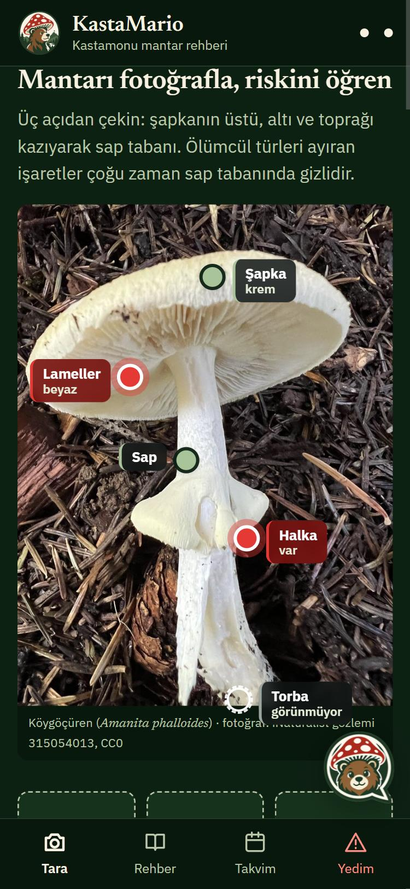
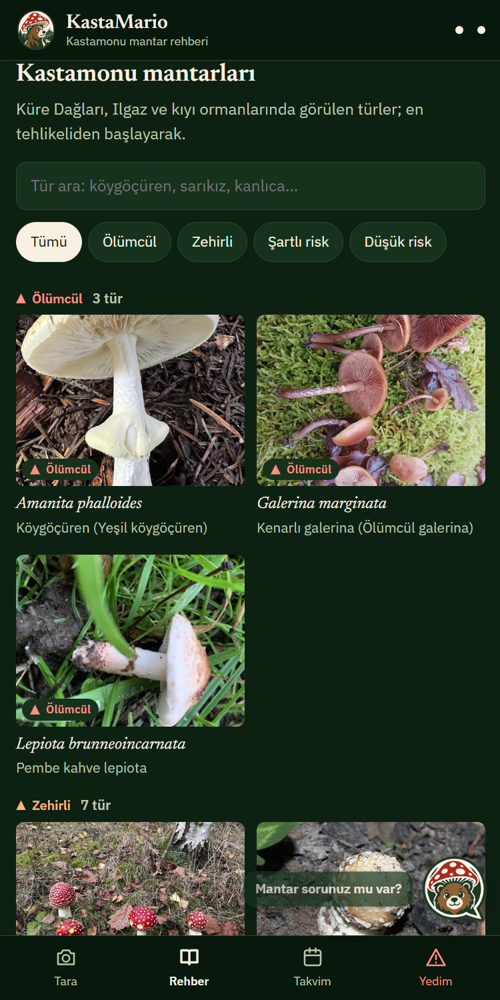
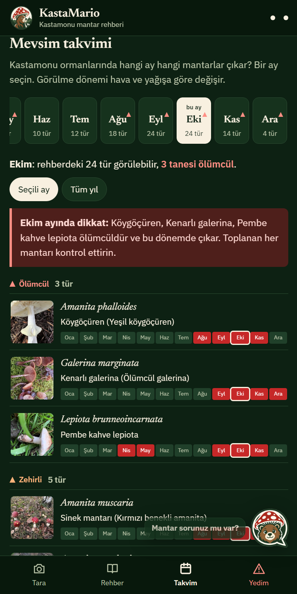
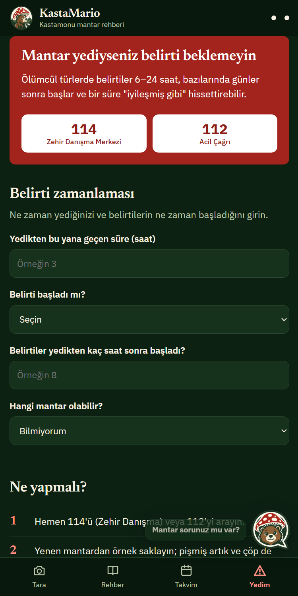

# 🍄 KastaMario — Kastamonu mantar rehberi


**Yapay zekâ destekli mantar zehirlenme risk rehberi.** Mantarın fotoğrafını çekin; KastaMario olası türleri, zehirlenme riskini, ölümcül ikiz türleri, belirtilerin kaç saatte başladığını, yediyseniz ne yapmanız gerektiğini, mantarın nerede ve ne zaman yetiştiğini gösterir. Kastamonu ormanları (Küre Dağları, Ilgaz, kıyı kestane-meşe ormanları) için hazırlanmıştır.

> KastaMario **hiçbir mantarın yenilebilir olduğunu söylemez.** Zehirliyi yenilebilir sanmak ölümcül olabilir; yenilebiliri zehirli sanmak en fazla boş sepettir. Bu asimetri tasarımın temelidir.

| Tara | Rehber | Takvim | Yedim! |
|:---:|:---:|:---:|:---:|
|  |  |  |  |

## Yapay zekâ ne yapıyor?

KastaMario iki açık modeli ve kural tabanlı bir güvenlik katmanını birlikte kullanır:

| Katman | Model | Lisans | Görevi |
|---|---|---|---|
| 1. Görüntü sınıflandırıcı | **EfficientNet-B0**, bu projede iNaturalist fotoğraflarıyla eğitildi (`ml/train.py`) | Kod MIT; ön eğitimli ağırlıklar [torchvision (BSD-3)](https://github.com/pytorch/vision/blob/main/LICENSE) | Fotoğraftan tür olasılıkları + "mantar değil" tespiti. ONNX olarak **cihazda, internetsiz** çalışır. |
| 2. Görsel-dil modeli | **[Gemma 4 26B A4B](https://huggingface.co/google/gemma-4-26B-A4B-it)** (Google DeepMind, açık ağırlıklı; 26 milyar parametreli, her adımda ~4 milyarı etkin MoE modeli) — [Gemini API](https://ai.google.dev/gemma/docs/core/gemma_on_gemini_api) üzerinden, model kimliği `gemma-4-26b-a4b-it` | [Apache 2.0 — Gemma 4 lisansı](https://ai.google.dev/gemma/docs/gemma_4_license) | Fotoğraftaki ayırt edici özellikleri **yapılandırılmış JSON** olarak çıkarır (sap tabanında torba, halka, lamel rengi, alt yüz tipi, substrat); bilgi tabanına dayalı Türkçe asistan. |
| 3. Güvenlik kuralları | — | MIT | **En kötü aday kuralı**: adaylardan biri ≥%5 ihtimalle ölümcül/zehirliyse sonuç KIRMIZI. Gemma bulguları riski **yalnızca yükseltebilir**, asla düşüremez. |

### Örnek: Gemma 4 riski nasıl yükseltir?
Görüntü modeli bir mantarı %70 "çayır mantarı" görür. Gemma 4 fotoğrafta **sap tabanında torba** tespit eder → kural katmanı sonucu **KIRMIZI**'ya çeker: *"Sap tabanında torba görünüyor. Bu, ölümcül köygöçüren grubunun en önemli işaretidir."*

```
Fotoğraf ─┬─► [1] EfficientNet-B0 (cihazda) ──► top-5 tür + mantar mı?
          │                                        │
          └─► [2] Gemma 4 (sunucu → Gemini API) ──► görsel özellikler (JSON)
                                                   │
                     [3] Güvenlik kuralları ◄──────┘
                     • en kötü aday kuralı         → 🔴 Zehirli olabilir
                     • belirsizlik eşiği (%60)     → 🟡 Emin değiliz
                     • Gemma risk yükseltmesi      → ⚪ Düşük riskli aday (uzman onayı şart)
                                                   → ⛔ Mantar değil
                     ▼
     Sonuç + ikiz tür uyarıları + belirti süresi + ilk yardım + Kastamonu takvimi
```

## Sonuçlar (test seti — modelin eğitimde hiç görmediği 1.779 fotoğraf)

| Metrik | Değer |
|---|---:|
| Doğru tür ilk tahminde (top-1) / ilk 5'te (top-5) | **%90,7 / %98,6** |
| Ölümcül tür fotoğrafının **KIRMIZI** gösterilmesi | **%99,3** |
| Ölümcül veya zehirli tür fotoğrafının **KIRMIZI** gösterilmesi | **%98,5** |
| **Tehlikeli karışıklık** (zehirli → "düşük riskli aday") | **%0,8** |
| Zehirli türün "mantar değil" sayılması | %0 |
| Kalibrasyon hatası (ECE), sıcaklık ölçeklemeyle | 0,110 → 0,018 |
| Telefonda tahmin süresi (ONNX, internetsiz) | ~0,14 sn |

Model bazı türleri tek başına zor tanır (ör. *Armillaria mellea* recall %70,8), ama **en kötü aday kuralı** sayesinde ölümcül tür fotoğraflarının %99,3'ü yine KIRMIZI gösterilir: yapay zekâ ile güvenlik kuralları birlikte çalışır. Ayrıntı: [`results/egitim_raporu.md`](results/egitim_raporu.md).

### Dış test: internetten bulunan fotoğraflar
iNaturalist fotoğrafları birbirine benzer (elde, yakın çekim). Gerçek kullanımı ölçmek için modelin hiç görmediği, farklı kaynaktan **315 Wikimedia Commons fotoğrafı** ile ayrıca test edildi (`ml/commons_test.py`, `ml/eval_dis.py`). İlk sürüm internet/ekran fotoğraflarında zayıftı; eğitime **dayanıklılık artırımı** (döndürme, uzaklaştırma, renk sıcaklığı, bulanıklık, gürültü) ve uygulamaya **çoklu bakış** (orta kare + tam görüntü + ayna, olasılık ortalaması) eklendi:

| Commons (315 fotoğraf) | İlk model | Son model + çoklu bakış |
|---|---:|---:|
| top-1 | %75,6 | **%78,4** |
| top-5 | %91,4 | **%94,6** |
| Tehlikeli tür → KIRMIZI | %93,8 | **%94,6** |

Aynı modelin iNaturalist test setinde çoklu bakışla top-1'i **%91,2**'dir. Ayrıntı: [`results/dis_test.json`](results/dis_test.json).

### Gemma 4'ün katkısını da ölçtük
151 test fotoğrafı iki yoldan geçirildi: yalnızca görüntü modeli ve görüntü modeli + Gemma 4 (`ml/eval_gemma.py`). Ayrıntı: [`results/gemma_degerlendirme.md`](results/gemma_degerlendirme.md).

| | Yalnızca model | Model + Gemma 4 |
|---|---:|---:|
| Zehirli/ölümcül tür → KIRMIZI (n=80) | %98,8 | %98,8 |
| Düşük riskli türde gereksiz KIRMIZI alarm (n=48) | — | **%0** |
| Gemma API hatası (151 fotoğraf) | — | **0** |

Bu test setinde görüntü modeli tehlikeli türlerin %98,8'ini zaten KIRMIZI gösterdiği için Gemma'nın risk yükseltmesi ek bir fotoğrafı kurtarmadı. Gereksiz alarm da üretmedi. Gemma'nın Amanita fotoğraflarında sap tabanındaki torbayı görme oranı %8'de kaldı (n=24). iNaturalist fotoğrafları tek açıdan çekilmiş ve çoğunda sap tabanı toprağın içinde. Uygulamanın ayrıca "sap tabanı" fotoğrafı istemesinin nedeni bu. Gemma'nın bugünkü asıl katkısı **açıklanabilirlik** (hangi işareti gördüğünü anatomi fotoğrafında göstermesi) ve **Mybear asistanı**. Görüntü modelinin zorlandığı fotoğraflarda ise ikinci bir güvenlik ağı görevi görüyor.

## Özellikler
- 📷 **Tara:** şapka üstü, şapka altı ve sap tabanı için üç fotoğraf yuvası → görüntü modeli ve Gemma 4 **paralel** çalışır → risk, en olası 5 tür, "karıştırılabilecek tehlikeli türler". Gemma'nın bulguları gerçek bir köygöçüren fotoğrafı üzerindeki anatomi işaretlerinde gösterilir (torba bulunursa kırmızı yanar).
- 🐻 **Mybear (Gemma 4):** köşedeki balona dokununca açılan sohbet; yanıtlar akarak gelir, internet yoksa **çevrimdışı modda** rehber bilgisinden yanıt verir. "Kastamonu'daki mantarları listele", "Yedim ne yapmalıyım?", "Köygöçüreni yumurta mantarından nasıl ayırırım?" — rehberdeki 27 türün tam kataloğu + soruyla ilgili türlerin ayrıntıları (RAG); madde madde, biçimli yanıtlar; yasak ifadeler süzülür
- 📖 **Rehber:** 27 tür (yöresel **saçak** ve **koçak** dahil), her biri CC lisanslı fotoğraf ve atıfla — zehirlilik, belirtiler, etki süresi, ilk yardım, boy, yetişme süreci, Kastamonu notu, Türkiye gözlem kayıtları (GBIF), iNaturalist/GBIF ve klinik literatür kaynakları
- 📅 **Takvim:** ay seçici (her ayın tür sayısı, ölümcül tür uyarısı) + seçili ayın türleri; tüm yıl için fenoloji tablosu
- 🚨 **Yedim!:** 114 (UZEM) / 112, belirti zaman çizelgesi (6 saatten geç başlayan belirti → ölümcül zehirlenme uyarısı)
- 📱 **Mobil:** PWA (ana ekrana eklenebilir, yazı tipleri dahil çevrimdışı çalışır); Capacitor ile Android/iOS paketine hazır

**Hız:** Gemma 4'ün yanıt öncesi "düşünme" adımı `thinkingLevel: minimal` ile kısıtlandı. İki fotoğraflı görsel analiz **~180 sn → ~5 sn**'ye indi ve ölçümlerde aynı özellikleri buldu (`MYCOGUARD_THINKING` ile değiştirilebilir).

## Hızlı başlangıç

```bash
git clone https://github.com/SelamiKalay/BAKLAVA.git
cd BAKLAVA
```

**1. Gemini API anahtarı alın** (Gemma 4 ücretsiz katmanda): https://aistudio.google.com/apikey

**2. Uygulamayı başlatın** (yalnızca Python 3.10+, ek paket gerekmez):

```bash
GEMINI_API_KEY=<anahtarınız> python server/app.py
```

Tarayıcıda `http://localhost:8000` adresini açın. Anahtar yoksa ya da internet kesikse uygulama görüntü modeli + güvenlik kurallarıyla çalışmaya devam eder; Gemma adımı "kullanılamıyor" görünür.

**Başka sağlayıcı** (OpenAI uyumlu herhangi bir uç; ör. DigitalOcean Serverless Inference, Hugging Face, vLLM, Ollama):

```bash
MYCOGUARD_LLM=openai OPENAI_BASE_URL=https://.../v1 OPENAI_API_KEY=... MYCOGUARD_MODEL=<model-id> python server/app.py
```

**Telefona aktarma ve sunucuyu yayımlama:** [`docs/mobil.md`](docs/mobil.md) — DigitalOcean App Platform (`.do/app.yaml`) ve Capacitor (Android/iOS).

> **Gizlilik:** Gemma 4 adımında fotoğraf ve sorular sunucu üzerinden Google Gemini API'ye gönderilir; ücretsiz katmanda bu veriler Google ürünlerini geliştirmek için kullanılabilir. Tür tahmini, rehber, takvim ve acil durum bölümleri tamamen telefonda çalışır ve hiçbir veri göndermez.

## Veri ve model hattı (yeniden üretmek için)

```bash
pip install -r requirements-ml.txt
python ml/collect.py        # 1. ham veri: iNaturalist fotoğrafları + GBIF Türkiye kayıtları
python ml/clean.py          # 2. temizleme ve ayrıştırma -> data/clean/ + temizlik_raporu.md
python ml/train.py          # 3. EfficientNet-B0 eğitimi -> app/model/*.onnx + results/
python ml/eval_gemma.py     # 4. Gemma 4'ün katkısı (test fotoğrafları, .env'de GEMINI_API_KEY gerekir)
python ml/thumbs.py         # rehber fotoğrafları (CC lisanslı, atıflı)
python ml/kaynaklar.py      # tür sayfaları için iNaturalist/GBIF bağlantıları
python src/build_app_data.py
```

**Eğitim hızı:** `ml/train.py` fotoğrafları ilk çalıştırmada bir kez çözüp `%LOCALAPPDATA%\mycoguard\` altına 256×256 önbellek olarak yazar (~2,2 GB; OneDrive dışında, `MYCOGUARD_CACHE` ile değiştirilebilir) ve eğitim sırasında GPU belleğinde tutar; veri artırma (rastgele kırpma, çevirme, renk) toplu halde GPU'da yapılır. Windows'ta klasik DataLoader işçileriyle adım başına ~9,5 sn ölçülürken GPU'nun kendisi 0,26 sn/adım hızındaydı; bu yaklaşım darboğazı kaldırır. Eğitim internet gerektirmez.

**Veri temizleme adımları** (`ml/clean.py`, ayrıntı `data/clean/temizlik_raporu.md`): yinelenen kayıtlar, lisans filtresi (yalnızca CC), taksonomi normalizasyonu (alt tür/varyete → tür), bozuk/küçük/aykırı en-boy oranlı görseller, **algısal hash (dHash) ile birebir ve neredeyse kopya fotoğraflar**, tarih/konum ayrıştırma, sınıf dengeleme ve **gözlem kimliğine göre sızıntısız train/val/test ayrımı**. GBIF tarafında: ABSENT kayıtlar, tür düzeyine indirgeme, Türkiye dışı/0-0/ters koordinatlar, aynı tür-yer-gün kopyaları ve il adı normalizasyonu ("KASTAMONU", "Kastamonu İli", "Kastamonu Province" → `kastamonu`).

**Model sonuçları:** `results/egitim_raporu.md` — top-1/top-5 doğruluk, sınıf bazında recall, kalibrasyon (ECE) ve güvenlik metrikleri: zehirli tür → KIRMIZI oranı ve **tehlikeli karışıklık oranı** (zehirli bir mantarın "düşük riskli" gösterilmesi; hedef ≈ 0).

## Testler

```bash
python -m pytest -q
```

| Test dosyası | Ne doğrular |
|---|---|
| `tests/test_decide.py` | 8 örnek vaka, eşik sınırları, en kötü aday kuralı, her tehlikeli tür birinci adaysa KIRMIZI |
| `tests/test_species_table.py` | Tür tablosu şeması, aylar, belirti saatleri, ikiz türler, tehlikeli türler "Toplanmaz", "güvenli" ifadesi yasağı |
| `tests/test_parity.py` | Tarayıcıdaki `app/decide.js` ile `src/decide.py` 2000 rastgele vakada aynı kararı veriyor; Gemma risk yükseltmesi (`escalate`) iki dilde aynı |
| `tests/test_gemma.py` | Gemma risk yükseltme kuralları, riskin asla düşmemesi, yasak ifade süzgeci, RAG bağlamı, Gemini ve OpenAI uyumlu istek biçimleri, şema dışı çıktının güvenli varsayılana düşmesi, istek sınırı |
| `tests/test_clean.py` | İl adı/tür adı/tarih/konum ayrıştırma, lisans filtresi, dHash kopya tespiti, sızıntısız ayırma, dengeleme |
| `tests/test_train.py` | Eğitim veri hattı (yalnızca CPU): orta kırpma, önbelleğin yeniden kullanımı, GPU veri artırma, toplu üretimi |

## Proje yapısı

```
├── app/                  # Mobil uyumlu web uygulaması (PWA)
│   ├── index.html        #   arayüz
│   ├── decide.js         #   güvenlik kuralları (Python ile eşdeğer)
│   ├── model.js          #   cihazda ONNX çıkarımı (onnxruntime-web)
│   ├── model/            #   eğitilmiş model + etiketler
│   └── vendor/ort/       #   onnxruntime-web 1.20.1 (MIT)
├── server/               # Gemma 4 uç noktaları + statik sunucu (bağımlılıksız)
├── ml/                   # collect -> clean -> train -> thumbs
├── src/                  # karar katmanı (Python) + uygulama verisi üretimi
├── data/                 # species_info.csv, demo_cases.json, clean/ (raw/ repoya girmez)
├── results/              # eğitim raporu, metrikler, grafikler
├── tests/                # pytest
└── docs/                 # veri kaynakları, güvenlik-etik, günlük
```

## Bağımlılıklar ve lisanslar

| Bileşen | Lisans |
|---|---|
| KastaMario kodu | MIT (`LICENSE`) |
| Gemma 4 26B A4B (Gemini API) | [Apache 2.0](https://ai.google.dev/gemma/docs/gemma_4_license) |
| PyTorch / torchvision (EfficientNet-B0 ağırlıkları) | BSD-3 |
| onnxruntime-web 1.20.1 | MIT |
| IBM Plex Sans, Newsreader (yerel kopya, `app/fonts/`) | SIL Open Font License 1.1 |
| Anatomi fotoğrafı (`app/img/anatomi.jpg`) | [iNaturalist gözlemi 315054013](https://www.inaturalist.org/observations/315054013), CC0 |
| iNaturalist fotoğrafları | Her fotoğrafın kendi CC lisansı; atıflar `data/clean/thumbs.json` ve `data/clean/inat_clean.csv` içinde |
| GBIF kayıtları | Kayıt başına CC0 / CC BY / CC BY-NC — bkz. `docs/veri-kaynaklari.md` |

## Ekip

| | GitHub |
|---|---|
| Selami Kalay | [@SelamiKalay](https://github.com/SelamiKalay) |
| | [@emoylmz01](https://github.com/emoylmz01) |
| | [@rifo5](https://github.com/rifo5) |

## Sorumluluk reddi
KastaMario bilgilendirme amaçlıdır; tıbbi tavsiye veya uzman tür tanımının yerine geçmez. Model hata yapabilir; bu yüzden güvenlik kuralları her zaman en kötü olasılığı esas alır. Mantar yediyseniz belirti beklemeden **112** veya **114**'ü (Ulusal Zehir Danışma Merkezi) arayın.
