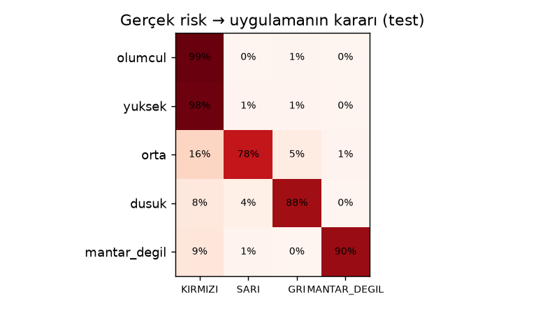
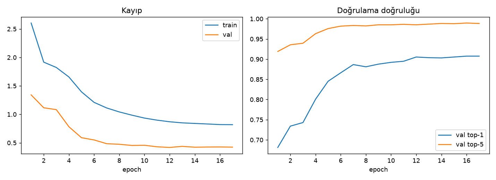
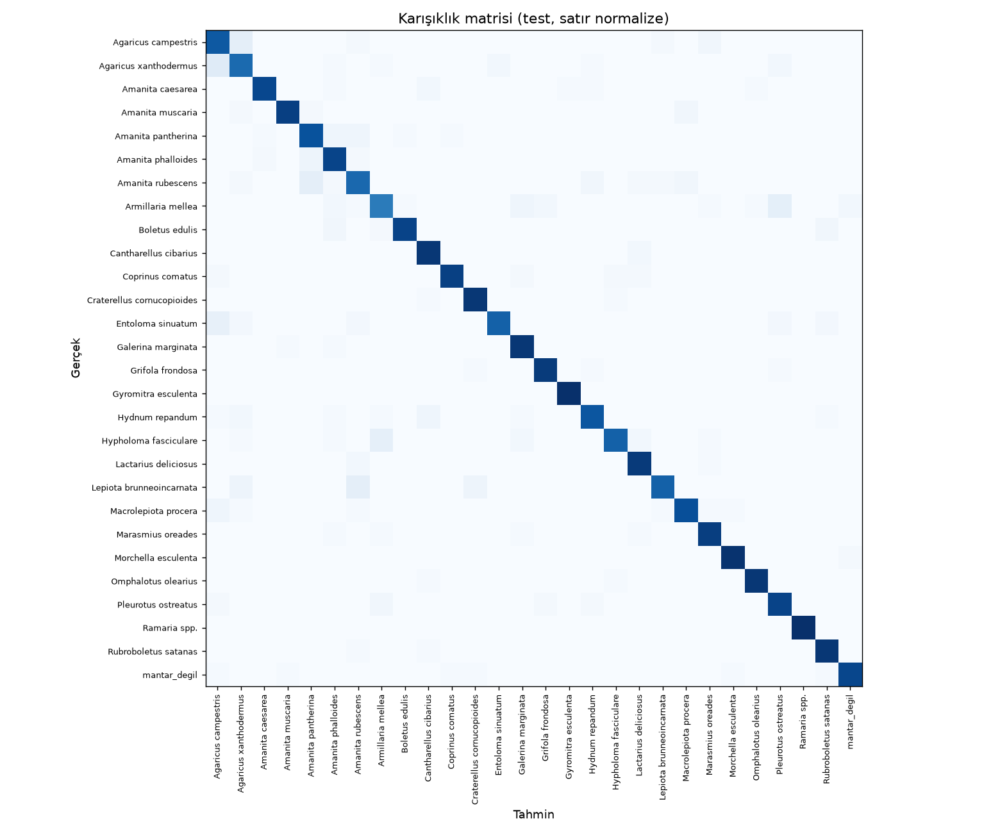

# Model eğitim raporu

**Model:** EfficientNet-B0 (ImageNet ön eğitimli, transfer öğrenme) · **28 sınıf** · train 8462 / val 1816 / test 1779 fotoğraf

## Genel başarı (test seti — eğitimde hiç görülmedi)

| Metrik | Değer |
|---|---:|
| Top-1 doğruluk | 90.7% |
| Top-5 doğruluk | 98.6% |
| Makro recall | 90.3% |
| Kalibrasyon hatası (ECE) ham → kalibre | 0.110 → 0.018 (T=0.68) |

## Güvenlik metrikleri (model + karar katmanı birlikte)

| Metrik | Değer | Hedef |
|---|---:|---|
| Ölümcül/zehirli tür fotoğrafının KIRMIZI gösterilme oranı | 98.5% | yüksek |
| Ölümcül tür fotoğrafının KIRMIZI gösterilme oranı | 99.3% | yüksek |
| **Tehlikeli karışıklık** (zehirli → 'düşük riskli aday') | **0.8%** | ≈ 0 |
| Zehirli tür fotoğrafının 'mantar değil' sayılması | 0.0% | ≈ 0 |
| Mantar olmayan fotoğrafların reddedilmesi | 89.6% | yüksek |
| Düşük riskli türlerde GRİ sonuç (gereksiz alarm olmaması) | 88.0% | — |

### Gerçek risk → uygulamanın kararı (adet)

| Gerçek risk | KIRMIZI | SARI | GRI | MANTAR_DEGIL |
|---|---:|---:|---:|---:|
| olumcul | 152 | 0 | 1 | 0 |
| yuksek | 431 | 4 | 4 | 0 |
| orta | 53 | 253 | 17 | 3 |
| dusuk | 66 | 29 | 699 | 0 |
| mantar_degil | 6 | 1 | 0 | 60 |

## Sınıf bazında recall (test)

| Sınıf | Risk | Recall |
|---|---|---:|
| *Agaricus campestris* | dusuk | 84.1% |
| *Agaricus xanthodermus* | orta | 77.6% |
| *Amanita caesarea* | dusuk | 90.9% |
| *Amanita muscaria* | yuksek | 93.8% |
| *Amanita pantherina* | yuksek | 86.8% |
| *Amanita phalloides* | olumcul | 92.1% |
| *Amanita rubescens* | orta | 78.1% |
| *Armillaria mellea* | orta | 70.8% |
| *Boletus edulis* | dusuk | 92.2% |
| *Cantharellus cibarius* | dusuk | 97.0% |
| *Coprinus comatus* | dusuk | 93.5% |
| *Craterellus cornucopioides* | dusuk | 97.0% |
| *Entoloma sinuatum* | yuksek | 81.1% |
| *Galerina marginata* | olumcul | 97.1% |
| *Grifola frondosa* | dusuk | 95.5% |
| *Gyromitra esculenta* | yuksek | 100.0% |
| *Hydnum repandum* | dusuk | 85.3% |
| *Hypholoma fasciculare* | yuksek | 80.9% |
| *Lactarius deliciosus* | dusuk | 95.7% |
| *Lepiota brunneoincarnata* | olumcul | 81.0% |
| *Macrolepiota procera* | dusuk | 88.2% |
| *Marasmius oreades* | dusuk | 94.2% |
| *Morchella esculenta* | orta | 98.4% |
| *Omphalotus olearius* | yuksek | 97.2% |
| *Pleurotus ostreatus* | dusuk | 92.2% |
| *Ramaria spp.* | orta | 100.0% |
| *Rubroboletus satanas* | yuksek | 97.1% |
| *mantar_degil* | — | 91.0% |

ONNX dışa aktarma doğrulaması: PyTorch ile en büyük çıktı farkı 5.81e-06.
